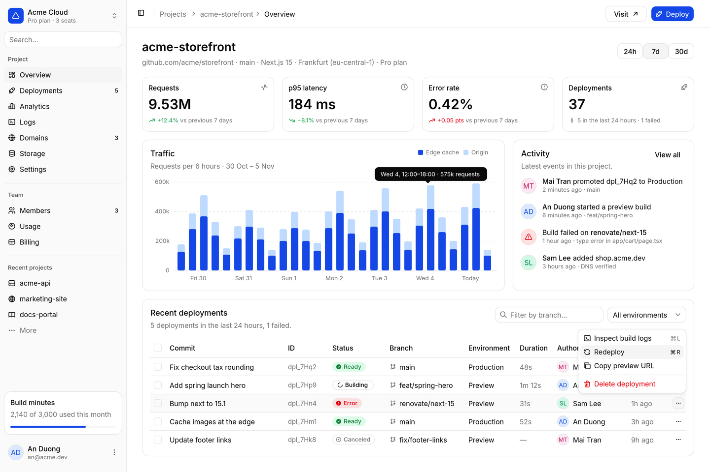
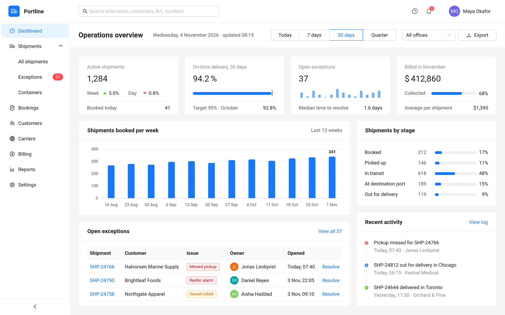

# Evolus Pencil Stencils Repository

Stencil collections and icon bundles for [Evolus Pencil](https://pencil.evolus.vn/). Pencil reads the XML feeds in this repository to list, download and install collections.

| Feed | URL | Contents |
| :--- | :--- | :--- |
| Official (built in) | [`repository.xml`](https://raw.githubusercontent.com/evolus/stencils-repository/master/repository.xml) | shadcn/ui, Ant Design, Material mockups, wireframes, authoring tools |
| Evolus extended | [`repository-evolus.xml`](https://raw.githubusercontent.com/evolus/stencils-repository/master/repository-evolus.xml) | Diagrams, notes and SVG icon bundles |
| Legacy | [`repository-outdated.xml`](https://raw.githubusercontent.com/evolus/stencils-repository/master/repository-outdated.xml) | Old platforms, kept for opening old documents |

## New: shadcn/ui Design



`evolus.pencil.shadcn2026` follows shadcn/ui (Radix base, style nova):
- 35 shapes and 173 named styles for sidebars, forms, tables, cards, menus, dialogs, sheets, toasts and chat;
- Lucide icons and the embedded Inter font;
- collection settings for style, base color, accent, light or dark mode, radius and font;
- built-in instructions for AI agents designing through Pencil MCP.

**Requires Pencil 4.0.0 or later.** [Download ZIP](https://raw.githubusercontent.com/evolus/stencils-repository/master/evolus.pencil.shadcn2026/evolus.pencil.shadcn2026.zip) (MIT; Lucide icons under ISC, Inter under OFL-1.1).

## New: Ant Design 2026



`evolus.pencil.ant2026` matches Ant Design 5 (antd 5.29.3) by measurement:
- 42 shapes and 185 named styles for layouts, menus, forms, tables, cards, tags, steps, timelines, alerts, modals, drawers and messages;
- real Ant icons and the embedded Roboto font;
- one `primaryColor`, `borderRadius` and `defaultFont` to restyle new shapes;
- built-in instructions for AI agents designing through Pencil MCP.

**Requires Pencil 4.0.0 or later.** [Download ZIP](https://raw.githubusercontent.com/evolus/stencils-repository/master/evolus.pencil.ant2026/evolus.pencil.ant2026.zip) (MIT; Roboto under Apache 2.0).

## Installing a collection

- **From a feed:** *Tools › Manage Collections… › Install From Repository…*, pick the feed, then *Install*.
- **From a ZIP:** download it from the tables below, then *Tools › Manage Collections… › Install From File…*.
- **Add another feed:** *Settings › Advanced*, filter `repo`, edit `collection.repo.extra_repo_urls` to `Name=URL` (separate several with `|`), for example:
  ```text
  Evolus=https://raw.githubusercontent.com/evolus/stencils-repository/master/repository-evolus.xml
  ```

## Official feed (`repository.xml`)

| Collection | ID | Version | Pencil | License | Download |
| :--- | :--- | :---: | :---: | :---: | :---: |
| shadcn/ui Design | `evolus.pencil.shadcn2026` | 1.0.0 | 4.0.0+ | MIT | [ZIP](https://raw.githubusercontent.com/evolus/stencils-repository/master/evolus.pencil.shadcn2026/evolus.pencil.shadcn2026.zip) |
| Ant Design 2026 | `evolus.pencil.ant2026` | 1.0.0 | 4.0.0+ | MIT | [ZIP](https://raw.githubusercontent.com/evolus/stencils-repository/master/evolus.pencil.ant2026/evolus.pencil.ant2026.zip) |
| Generic Wireframe | `dgthanhan.GenericWireframe` | 1.0 | 3.0.2+ | MIT | [ZIP](https://github.com/dgthanhan/stencils/releases/download/SB-1.0-WF/GenericWireframe-1.0.zip) |
| Desktop Material Mockup | `dgthanhan.MaterialDesktopMockup` | 1.0.4 | 3.0.4+ | MIT | [ZIP](https://github.com/dgthanhan/stencils/releases/download/DMM1.0.4/DesktopMaterialMockup-1.0.4.zip) |
| Mobile Material Mockup | `dgthanhan.AndroidNougatWireframe` | 0.9 | 3.0.4+ | MIT | [ZIP](https://github.com/dgthanhan/stencils/releases/download/MMM091/MobileMaterialMockup-0.9.1.zip) |
| Community Material Vector Icons | `icons.CommunityMaterialIcons` | 1.1 | 3.0.2+ | OFL-1.1 | [ZIP](https://github.com/evolus/stencils-repository/raw/refs/heads/master/ResourceBundles/CommunityMaterialIconsResourceBundle-1.1.zip) |
| Stencil Builder Shapes | `Evolus.UI.StencilBuilder` | 1.1 | 3.0.2+ | MIT | [ZIP](https://github.com/dgthanhan/stencils/releases/download/SB-1.1/StencilBuilder-1.1.zip) |
| Gnome 3 Widgets | `Evolus.UI.Gnome3` | 1.0 | any | MIT | [ZIP](https://github.com/dgthanhan/stencils/releases/download/v1.0.0/Gnome3UI-1.0.zip) |
| Evolus QC Tools | `evolus.QCTools` | 1.0 | 3.0.4+ | MIT | [ZIP](https://github.com/dgthanhan/stencils/releases/download/QCTools-1.0/QCTools-1.0.zip) |

## Evolus extended feed (`repository-evolus.xml`)

All packages are hosted in this repository. Version 1.0, MIT.

| Collection | ID | Download |
| :--- | :--- | :---: |
| Simple Database Schema | `dgthanhan.ERDSimple` | [ZIP](https://raw.githubusercontent.com/evolus/stencils-repository/master/dgthanhan.ERDSimple/dgthanhan_ERDSimple-1.0.zip) |
| MDM - Data Widgets | `evolus.mdm.data` | [ZIP](https://raw.githubusercontent.com/evolus/stencils-repository/master/evolus.mdm.data/evolus_mdm_data-1.0.zip) |
| Ultimate Note Collection | `dgthanhan.UltimateNote` | [ZIP](https://raw.githubusercontent.com/evolus/stencils-repository/master/dgthanhan.UltimateNote/dgthanhan_UltimateNote-1.0.zip) |
| Uncategorized Shapes | `evolus.Uncategorized` | [ZIP](https://raw.githubusercontent.com/evolus/stencils-repository/master/Uncategorized/evolus_Uncategorized-1.0.zip) |
| Meme 01 | `dgthanhan.Meme01` | [ZIP](https://raw.githubusercontent.com/evolus/stencils-repository/master/dgthanhan.Meme01/dgthanhan_Meme01-1.0.zip) |
| Rage Comic Faces | `dgthanhan.Meme02` | [ZIP](https://raw.githubusercontent.com/evolus/stencils-repository/master/dgthanhan.Meme02/dgthanhan_Meme02-1.0.zip) |

**SVG icon bundles** for Pencil's resource browser:
[Bootstrap](https://raw.githubusercontent.com/evolus/stencils-repository/master/ResourceBundles/bootstrapOfficalIcons/bootstrapOfficalIcons-1.0.zip) ·
[Font Awesome](https://raw.githubusercontent.com/evolus/stencils-repository/master/ResourceBundles/fontawesomeIcons/fontawesomeIcons-1.0.zip) ·
[Glow UI](https://raw.githubusercontent.com/evolus/stencils-repository/master/ResourceBundles/glowIcons/glowIcons-1.0.zip) ·
[Heroicons Outline](https://raw.githubusercontent.com/evolus/stencils-repository/master/ResourceBundles/heroiconsOutlineIcons/heroiconsOutlineIcons-1.0.zip) ·
[Heroicons Solid](https://raw.githubusercontent.com/evolus/stencils-repository/master/ResourceBundles/heroiconsSolidIcons/heroiconsSolidIcons-1.0.zip) ·
[Lucide](https://raw.githubusercontent.com/evolus/stencils-repository/master/ResourceBundles/lucideIcons/lucideIcons-1.0.zip) ·
[Tabler Filled](https://raw.githubusercontent.com/evolus/stencils-repository/master/ResourceBundles/tablerFilledIcons/tablerFilledIcons-1.0.zip) ·
[Tabler Outline](https://raw.githubusercontent.com/evolus/stencils-repository/master/ResourceBundles/tablerOutlineIcons/tablerOutlineIcons-1.0.zip)

## Legacy feed (`repository-outdated.xml`)

These collections are kept so that old `.ep` / `.epz` documents still open. They follow outdated platform guidelines.

| Collection | ID | License | Download |
| :--- | :--- | :---: | :---: |
| Mobile - Android ICS | `Evolus.AndroidICSHIFI` | GPL | [ZIP](http://evoluspencil.googlecode.com/files/Android.GUI_v2.zip) |
| Ext JS Neptune | `extJSKitchenSink` | GPL | [ZIP](https://googledrive.com/host/0B3r4pjcouweYYnF6MXNFNFo2Q00/ExtJSKitchenSink-Neptune-v0.9.zip) |
| Mobile - iOS UI Stencils | `Evolus.iOS` | GPL | [ZIP](http://evoluspencil.googlecode.com/files/iOS.GUI_v2.zip) |
| Mobile - iOS Wireframe | `Evolus.iOSWireframe` | GPL | [ZIP](http://evoluspencil.googlecode.com/files/iOS-Wireframe_v2.zip) |
| Dojo Widgets | `calle.bokedal.dojo.Widgets` | MIT | [ZIP](http://evoluspencil.googlecode.com/files/Dojo.GUI_v6.zip) |
| Bootstrap | `nz.nwatson.Bootstrap` | MIT | [ZIP](https://github.com/nathanielw/Bootstrap-Pencil-Stencils/releases/download/v1.1.0/bootstrap-pencil-stencils-v1.1.0.zip) |
| Android Lollipop | `nz.nwatson.AndroidLollipop` | MIT | [ZIP](https://github.com/nathanielw/Android-Lollipop-Pencil-Stencils/releases/download/v1.1.0/android-lollipop-pencil-stencils-v1.1.0.zip) |
| Material Icons | `nz.nwatson.MaterialIcons` | MIT | [ZIP](https://github.com/nathanielw/Material-Icons-for-Pencil/releases/download/v2.0.0/material-icons-for-pencil-v2.0.0.zip) |
| Twemoji | `nz.nwatson.Twemoji` | MIT | [ZIP](https://github.com/nathanielw/Twemoji-for-Pencil/releases/download/v1.1.0/twemoji-for-pencil-v1.1.0.zip) |
| Bootstrap Glyphicons | `co.uk.cfisk.BootstrapGlyphicons` | MIT | [ZIP](https://github.com/Craig-Fisk/BootstrapGlyph-Pencil-Stencil/archive/0.1.zip) |

## License

The repository files are [MIT](LICENSE). Each collection keeps the license listed in its feed entry.
